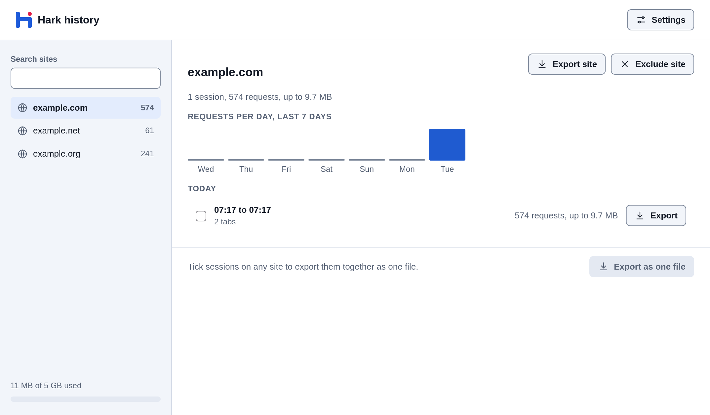

# Hark

Background HTTP recorder for Zen and Firefox-family Gecko builds that allow unsigned Experiment APIs. When a bug happens while DevTools is closed, Hark already recorded the tab's requests in the parent process and exports a HAR 1.2 file in one click, merging with DevTools if it was open.

**Browser requirement and trade-off.** Hark uses a privileged Gecko Experiment API and ships as an unsigned `.xpi`. Standard Firefox Release locks signature verification and blocks `experiment_apis`, so Hark cannot run there. Installing it requires setting `xpinstall.signatures.required` to `false`, which disables add-on signature checks for every extension in that browser profile. CI tests against pinned Zen `1.24.2b` (full suite on Linux; `export-failures` only on macOS and Windows). Firefox Developer Edition, Nightly, and unbranded builds expose the same APIs but are not tested in CI.

<p>
  <picture>
    <source media="(prefers-color-scheme: dark)" srcset="docs/screenshots/popup-dark.png">
    
  </picture>
</p>

## How it works

The recorder runs in Gecko's parent process as an [experiment API](docs/internals/glossary.md#processes-and-principals). At browser startup, before any `await`, it synchronously registers observers on `http-on-opening-request`, `http-on-examine-response`, `http-on-examine-cached-response`, `http-on-examine-merged-response`, `service-worker-synthesized-response`, and `http-on-stop-request` so the first requests of a session are captured.

- **Native body piping while recording.** At examine time, `BODY_ROUTES` decides from response headers whether to keep the body. `HEAD`, `1xx`, `204`, `205`, redirects, `text/event-stream`, and `multipart/x-mixed-replace` are skipped, and `audio/*` and `video/*` default to details only. Kept bodies copy through native `nsIStreamListenerTee` into `nsIStorageStream` packs (`< 1 MiB`) or `.part` files committed to `.body` files (`>= 1 MiB` or unknown length). During the brief startup retention scan, `file-tee` buffers up to `4 MiB` per stream and `16 MiB` total in RAM before flushing. While recording, no body byte passes through JavaScript, and nothing reads the HTTP cache because bare-URL cache keys can return bytes from a different request. See [Recording](docs/internals/recording.md) and [Recording in Gecko](docs/internals/recording-gecko.md).
- **Crash-recoverable per-site logs.** Request metadata appends one JSON line per exchange to `sites/<site>/log/<run>-<seq>.jsonl` with atomic `.summary.json` files on seal. On restart, `planReconcile` truncates torn lines and deletes orphaned `.part` and `.body` files.
- **Deterministic DevTools merge.** When DevTools was open, export pairs recording and DevTools entries strictly by `(run, channelId)`. Whole-group fields (request head, response head, timings) come intact from one source. Response bodies prefer the recording first and fall back to DevTools so truncated DevTools bodies are filled from disk. Every missing or cut-short body records its exact reason in `comment` and `entry._harExport`. See [Export](docs/internals/export.md) and [DevTools capture](docs/internals/devtools.md).
- **Pin-safe `O(k log N)` retention.** Body files and log segments sit in separate indexed min-heaps ordered oldest first. Active exports pin every file they read, and size eviction stops at the oldest pinned file instead of skipping past it to delete newer data. See [Retention](docs/internals/retention.md).

## Install

Build `hark-0.1.0.xpi` from source below (tagged releases also publish `.xpi` and `SHA256SUMS` via `.github/workflows/release.yml`, once the first tag is cut):

1. Open `about:config` and set:
   - `xpinstall.signatures.required` to `false` (disables signature verification for all extensions in this profile)
   - `extensions.experiments.enabled` to `true`
2. Restart the browser.
3. Open `about:addons`, open the gear menu, choose **Install Add-on From File**, and select `hark-0.1.0.xpi`.

## Using Hark

Click the toolbar button to save one of four exports, each showing its request count and size:

- This tab, everything since it opened
- This tab, recent
- This site, across every tab
- Everything recorded

Two popup toggles control whether to include response bodies and whether to remove secrets. Custom exports filter by scope, time window, fetch or XHR only, and file name, and continue running if the popup closes.

The **History** page groups recorded sites by daily request volume and sessions so you can combine ticked sessions from multiple sites into one HAR or exclude a site.

<p>
  <picture>
    <source media="(prefers-color-scheme: dark)" srcset="docs/screenshots/history-dark.png">
    
  </picture>
</p>

## Secret redaction and storage

When **Remove secrets** is enabled (`standard` redaction), Hark redacts in JavaScript during export:

- All request and response cookie values (`cookie`, `set-cookie`, and `cookies[]`).
- Twelve credential and proof header names (`authorization`, `proxy-authorization`, `x-api-key`, `api-key`, `x-api-token`, `x-auth-token`, `x-amz-security-token`, `x-csrf-token`, `x-xsrf-token`, `csrf-token`, `dpop`, and `signature`).
- Usernames and passwords in URLs (`url:userinfo`), including nested wrapper schemes.
- Sixteen secret parameter names (`access_token`, `refresh_token`, `id_token`, `token`, `api_key`, `apikey`, `key`, `client_secret`, `secret`, `password`, `auth`, `code`, `sig`, `signature`, `x-amz-signature`, and `x-amz-security-token`) in URL query strings, `request.queryString[]`, `application/x-www-form-urlencoded` request bodies (`postData.text` and `params[]`), JSON request bodies at any nesting depth, and `multipart/form-data` fields. Because generic names such as `key`, `code`, and `auth` match at any JSON depth, non-secret fields with those exact names in request JSON are redacted too.

**What `standard` redaction does not touch.** Response bodies (`response-body-json`, `response-body-base64`, and `response-body-other`) are not examined or redacted under `standard`. If an endpoint such as an OAuth `/token` response returns credentials in the response body, disable response bodies or scrub the exported file before sharing. Unparsed binary or custom request body formats (`request-body-other`) also remain unexamined, and the popup warns you when an export contains them. A full per-place coverage report is written into `log._harExport.redaction`.

In **Settings**, you can switch Secrets to **Never store** so credential header values and upload bodies are dropped at capture time (`entry._harExport.headersMissing = "never-stored"`).

<p>
  <picture>
    <source media="(prefers-color-scheme: dark)" srcset="docs/screenshots/settings-dark.png">
    
  </picture>
</p>

### Storage, isolation, and overhead

Settings offers 8 body-storage presets (`64 MB`, `256 MB`, `512 MB`, `1 GB`, `2 GB`, `5 GB`, `10 GB`, and `20 GB`; default `5 GB`) and 5 age limits (`1`, `3`, `7`, `14`, and `30` days; default `14`). Request metadata has a separate `1 GiB` cap (`16 MiB` floor). No benchmark of continuous recording CPU or disk overhead has been run yet.

Recordings live outside the browser profile under a 128-bit random directory key stored in `<profile>/hark.archive-key` so local `file://` pages cannot guess paths:

| Platform | Folder                                                       | Permissions                      |
| -------- | ------------------------------------------------------------ | -------------------------------- |
| Linux    | `$XDG_DATA_HOME/hark/<key>/` or `~/.local/share/hark/<key>/` | directories `0700`, files `0600` |
| macOS    | `~/Library/Application Support/Hark/<key>/`                  | directories `0700`, files `0600` |
| Windows  | `%LOCALAPPDATA%\Hark\<key>\`                                 | inherits `%LOCALAPPDATA%` ACL    |

Private windows are never recorded (an open DevTools panel in a private tab can still export when the add-on is allowed in private windows). Hark requests no host permissions and makes zero outbound network requests.

## Output HAR compatibility

Hark writes streaming HAR 1.2 files. To keep memory bounded during export, `log._harExportId` and `log.entries` appear before `version`, `creator`, and `pages` in the JSON object, and response bodies larger than `3 MiB` stream as `base64`. Both are valid HAR 1.2. You can open Hark exports directly in [Quipu](https://github.com/tretuttle/quipu) or any HAR viewer that accepts arbitrary JSON key order.

## Build and test

Requires Node `26` (`>=26.12.1 <27`) and pnpm `12.14.0`, pinned in `mise.toml` and `package.json`.

```sh
pnpm install
pnpm exec vp run check                   # fmt, lint, knip, typecheck, and all unit tests
pnpm --filter @hark/extension run pack   # writes reproducible apps/extension/dist/hark-0.1.0.xpi
```

Run the real-browser checks against a Gecko binary (CI pins Zen `1.24.2b` on Linux for the full suite, and runs `export-failures` on macOS and Windows):

```sh
pnpm --filter @hark/extension run verify:browser -- --binary /path/to/zen --check all
```

Architecture notes live under `docs/internals/`.

## License

MIT. See [LICENSE](LICENSE).
