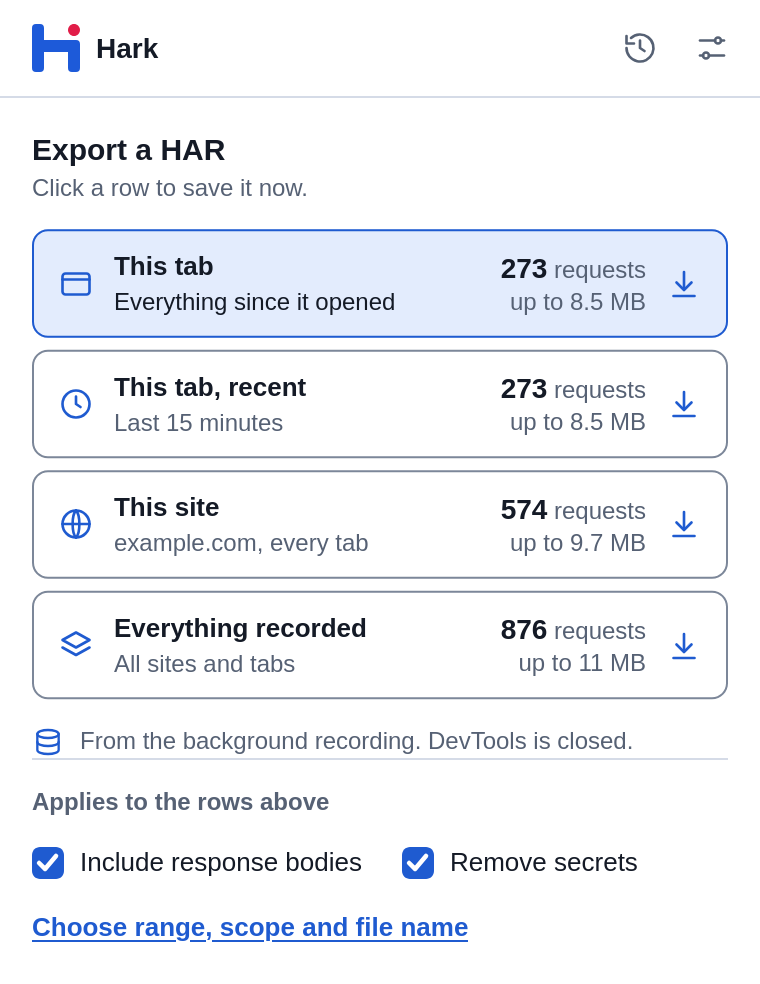
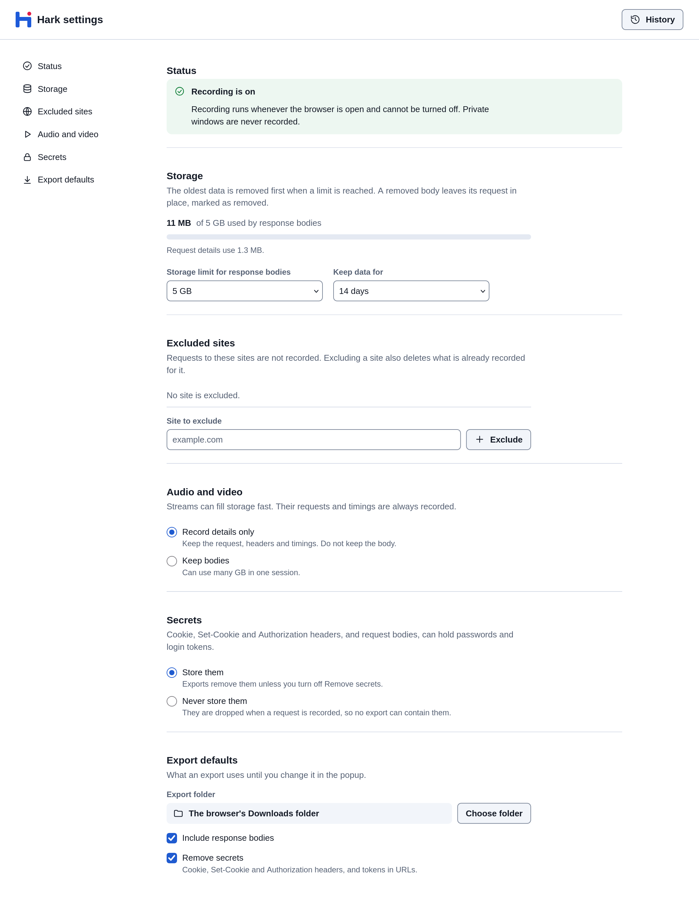

#  Hark

Hark is an extension for Zen and other Gecko browsers that saves a HAR file of a tab in one click. It records every HTTP request in the background, so the file includes what already happened, even when DevTools was never open. When DevTools is open, the export merges what it captured with the recording.

<p>
  <picture>
    <source media="(prefers-color-scheme: dark)" srcset="docs/screenshots/popup-dark.png">
    
  </picture>
</p>

<p>
  <picture>
    <source media="(prefers-color-scheme: dark)" srcset="docs/screenshots/history-dark.png">
    
  </picture>
</p>

<p>
  <picture>
    <source media="(prefers-color-scheme: dark)" srcset="docs/screenshots/settings-dark.png">
    
  </picture>
</p>

## How it works

The recorder runs in the browser's parent process, in the parent script of an [experiment API](docs/internals/glossary.md#processes-and-principals). At startup, before anything is awaited, it adds observers for `http-on-opening-request`, `http-on-examine-response`, `http-on-examine-cached-response`, `http-on-examine-merged-response`, `service-worker-synthesized-response` and `http-on-stop-request`, so the first request of a session is already recorded.

- **Bodies are copied while they arrive.** At the examine topic, a row of `BODY_ROUTES` decides from the response head alone whether the body is kept. A kept body is copied by a native `nsIStreamListenerTee`: a body with a declared length under 1 MiB goes into a native storage stream and is appended to the site's pack file, and any other body is written to a part file from its first byte. No body byte passes through script. Nothing is read from or written to the HTTP cache: a cache entry is keyed by the bare URL, so reading one back can return another request's bytes. See [Recording](docs/internals/recording.md) and [Recording in Gecko](docs/internals/recording-gecko.md).
- **Request details are one line per exchange** in an append-only log per site. A crash leaves files that the next start recovers from what is on disk.
- **An export merges two sources.** When DevTools is open on a tab, the requests its network monitor collected are the second source. Items pair on the run and the channel id, one request is one entry, and related fields (request head, response head, timings) come whole from one source. A body comes from the recording first and from DevTools second, so a body DevTools cut short is filled from the recording. Every body that is not in the file says why in its entry. See [Export](docs/internals/export.md) and [DevTools capture](docs/internals/devtools.md).
- **Retention evicts the oldest files first.** Bodies and request details have their own size caps and a shared age limit. Tracked files sit in indexed min-heaps ordered oldest first, so evicting k files from N costs O(k log N). An export pins the files it reads, and the size walk stops at the oldest pinned file instead of skipping past it, so an export never causes newer data to be deleted first. See [Retention](docs/internals/retention.md).

## Requirements

A Gecko browser that allows unsigned extensions and experiment APIs: Zen, Firefox Developer Edition, Firefox Nightly, or an unbranded Firefox build. Firefox Release does not allow either, so the extension does not run there.

## Install

1. Get the `.xpi`: download it from the [Releases](../../releases) page, or build it (see [Development](#development)).
2. Open `about:config` and set:
   - `xpinstall.signatures.required` to `false`
   - `extensions.experiments.enabled` to `true`
3. Restart the browser.
4. Open `about:addons`, use the gear menu to install an add-on from a file, and choose the `.xpi`.

## Using it

Click the toolbar button. The popup offers four ready-made exports, each with its request count and size, and one click saves the file:

- this tab, everything since it opened
- this tab, the last 15 minutes
- this site, across every tab
- everything recorded

Two toggles under the rows apply to all of them: whether to include response bodies, and whether to remove secrets. Removing secrets drops cookies, credential headers such as `Authorization` and API keys, secret query and body parameters, and user names and passwords in URLs, and writes a report of what was removed into the file. Both toggles start from the defaults on the settings page.

A custom export picks the scope (this tab, this site or all sites), a time range, an option to keep only fetch and XHR requests, and a file name, and shows the count before it starts. The export keeps running if the popup closes.

The history page lists the recorded sites. For the chosen site it shows requests per day over the last week and its sessions (activity with no gap longer than 30 minutes). Ticked sessions from any sites export as one file. A site can be excluded from there.

The settings page holds:

- **Storage:** the limit for response bodies (64 MiB to 20 GiB, 5 GiB by default) and how long data is kept (1 to 30 days, 14 by default). The oldest data is removed first; a removed body leaves its request in place, marked as removed.
- **Excluded sites:** sites that are never recorded. Excluding a site also deletes what is already recorded for it.
- **Audio and video:** record details only (the default), or keep their bodies too.
- **Secrets:** store cookie, authorization and similar header values and request bodies, or drop them when a request is recorded so no export can contain them.
- **Export defaults:** the export folder (the browser's Downloads folder by default) and the starting state of the two popup toggles. A folder inside the browser profile, the browser's own folders or the recording is refused.

What it never does:

- Private windows are not recorded. An export from a private tab can still use what an open DevTools panel captured, when the add-on is allowed to run in private windows.
- Nothing leaves the machine. The extension makes no network requests of its own.
- An export never overwrites a file. If the name is taken, it saves under the next free name, such as `<name> (2).har`.

## Where data lives

The recording is kept outside the browser profile, in a folder named by 128 random bits that are kept in the profile (`hark.archive-key`), so a local `file://` page cannot guess any path in it.

| Platform | Folder                                                        | Access                                                  |
| -------- | ------------------------------------------------------------- | ------------------------------------------------------- |
| Linux    | `$XDG_DATA_HOME/hark/<key>/`, or `~/.local/share/hark/<key>/` | directories `0700`, files `0600`                        |
| macOS    | `~/Library/Application Support/Hark/<key>/`                   | directories `0700`, files `0600`                        |
| Windows  | `%LOCALAPPDATA%\Hark\<key>\`                                  | inherits the access list of the user's `%LOCALAPPDATA%` |

Inside the browser, only the experiment API's parent script, running with the system principal, reads or writes these files. The extension's own pages get counts, site names, settings and job states from it, never a path or a body byte, and web pages reach nothing. Exported files are ordinary files in the export folder.

If the key file is lost, the next start makes a new key and a new, empty recording. The old folder is left untouched and can be deleted by hand.

## Platform support

CI runs on Linux, Windows and macOS against a pinned Zen build (1.24.2b):

- **Linux:** format, lint, unused-code check, typecheck, unit tests, packing and the shipped-output check on every pull request, and every browser check, including the history and settings page checks, against the packed extension.
- **Windows and macOS:** the `export-failures` browser check, which runs exports against that platform's file system and checks how each one finishes or fails.

The other browser checks run on Linux only.

## Development

Prerequisites: Node 26 (`>=26.12.1 <27`) and pnpm 12.14.0, both pinned in `package.json` and `mise.toml`.

```sh
pnpm install          # installs dependencies and the pre-commit hook
pnpm run check        # format, lint, unused-code check, typecheck and unit tests, as CI runs them
pnpm --filter @hark/extension run pack
```

`pack` builds the extension, writes `apps/extension/dist/hark-<version>.xpi`, and checks that every file in it is minified production output.

The browser checks start a browser through the harness, headless, with a throwaway profile:

```sh
pnpm --filter @hark/extension run verify:browser -- --binary /path/to/zen
node tools/browser-harness/src/cli.ts check --binary /path/to/zen --extension apps/extension/dist/hark-<version>.xpi
```

`verify:browser` runs the `environment` and `restart` checks by default; `--check all` runs every check. [Testing](docs/internals/testing.md) and [Browser harness](docs/internals/browser-harness.md) describe the rules and the harness.

`pnpm --filter @hark/extension run screenshot:readme -- --binary /path/to/zen` regenerates the screenshots at the top of this file from the packed extension.

Repository layout:

- `apps/extension`: the extension, built with extension.js. `src/` holds the popup, history and settings pages; `experiment/` holds the experiment API and its parent script.
- `packages/recording`: what is recorded, the archive layout, recovery and retention.
- `packages/export`: merging the sources and writing the HAR.
- `packages/har`: the HAR model and redaction.
- `tools/browser-harness`: the browser launcher, fixture server and real-browser checks.
- `oxlint-plugin-hark`: the repository's lint rules.
- `docs/internals`: architecture notes and the [glossary](docs/internals/glossary.md).

## License

[MIT](LICENSE)
